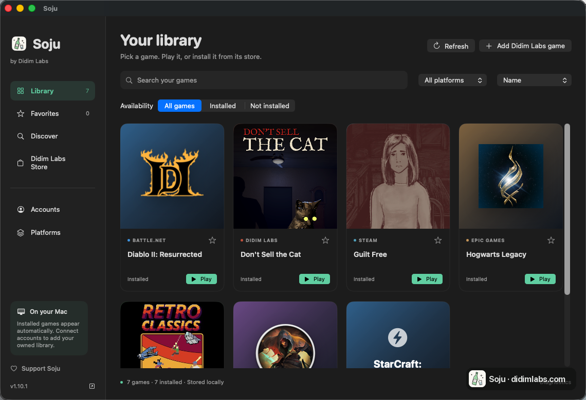

<p align="center"></p>

# Soju (한국어)

> **Apple Silicon 맥에서 Windows 게임을 하는 무료 오픈소스 앱.**

Soju는 M1 이후 맥에 **Battle.net·Steam·Epic Games·GOG GALAXY·EA 앱·Rockstar Games Launcher·Ubisoft Connect** 공식 Windows 런처를 설치하고, 런처마다 Wine 환경을 따로 두고, 게임을 맥 라이브러리 한 곳에 모아 보여줍니다. CrossOver 없이 Battle.net과 디아블로 2: 레저렉션을 돌리려고 시작한 프로젝트입니다.



**[Soju 1.12.0 맥 앱 받기](https://github.com/BCD1210/soju/releases/download/v1.12.0/Soju-1.12.0-macos-arm64.zip)**, 또는 터미널에서 설치:

```bash
brew install BCD1210/soju/soju
soju install
```

앱은 macOS 14 이상에서 돌아갑니다. 디아블로 2: 레저렉션은 macOS 26.4 이상, Steam 게임은 macOS 26 이상이 필요합니다.

[되는 것](#되는-것) · [설치 안내](#설치-한-줄) · [30초 게임 플레이 영상](https://didimlabs.com/#demo) · [맥에서 디아2 돌리기](https://didimlabs.com/guides/ko/diablo-2-mac.html) · [Discord](https://discord.gg/ttBDcF5ftz) · [English](README.md) · [简体中文](README.zh.md)

게임마다 호환성이 다르고, 커널 안티치트가 붙은 게임은 실행되지 않습니다. 게임과 스토어 클라이언트는 포함하지 않습니다. Apple GPTK 파일은 설치할 때 Soju가 받아 옵니다.

## 되는 것

<!-- 스크린샷: docs/images/ 에 PNG(d2r-ingame.png, battlenet-login.png, hogwarts-ingame.png)를 넣고 주석을 푸세요.
<p align="center">
  
  
</p>
-->

모두 M4 Pro / macOS 26.5에서 검증. 런처마다 별도 보틀을 사용하며, Steam은 엔진도 별도입니다.

| 런처 | 로그인 | 게임 설치 | 비고 |
| --- | :-: | :-: | --- |
| Battle.net | ✅ | ✅ | Agent 동작, `BLZBNTBNA00000005`는 서명 exe 시딩으로 해결 |
| Epic Games Launcher | ✅ | ✅ | 창을 닫으면 메뉴바 트레이로 |
| GOG GALAXY | ✅ | ✅ | 로그인·라이브러리까지, 게임은 아직 폭넓게 테스트 안 됨 |
| EA 앱 | 로그인 창 | 아직 테스트 안 함 | 1.11 신규, 런처 엔진(DXMT) |
| Rockstar Games Launcher | 로그인 창 | 아직 테스트 안 함 | 1.11 신규, 런처 엔진(DXMT) |
| Ubisoft Connect | 로그인 창 | 아직 테스트 안 함 | 1.11 신규, 런처 엔진(DXMT) |
| Steam (Windows 클라이언트) | ✅ | ✅ | 별도 Wine 11 + DXMT 보틀 |
| Xbox PC / Microsoft Store | ✅ | ✅ | Xodus 백엔드, 게임 실행은 실험 기능 (Retro Classics 메뉴까지 확인) |

| 게임 | 스토어 | 그래픽 | 상태 | 비고 |
| --- | --- | --- | :-: | --- |
| Diablo II: Resurrected | Battle.net | D3DMetal (D3D12) | ✅ 인게임, 온라인 | **macOS 26.4 이상**(전제조건 참고); `play.sh`가 `ROSETTA_ADVERTISE_AVX=1` 설정; [가이드](https://didimlabs.com/guides/ko/diablo-2-mac.html) |
| Diablo II: Resurrected VR(오프라인) | Battle.net | D3DMetal (D3D12) + OpenXR | 🧪 시뮬레이터만 확인 | `soju vr setup` / `soju vr play`: 오프라인 캐릭터용 D2R VR Unleashed, OXRSys 헤드셋 클라이언트로 스트리밍; [docs/VR.md](docs/VR.md) |
| Hogwarts Legacy | Epic | D3DMetal (D3D12) | ✅ 인게임 | UE4 "AMD 드라이버" 경고는 무해, 입력 소스를 영어로 |
| StarCraft: Remastered | Battle.net | 미확인 | ✅ 인게임 | 배틀넷에서 업데이트한 뒤 컴퓨터 상대 싱글 대전 시작까지 확인, 멀티플레이는 미확인 |
| Unity D3D11 타이틀 | Steam | DXMT | ✅ 인게임, 창 모드 | `soju steam-games` 필요, [docs/STEAM-GAMES.md](docs/STEAM-GAMES.md) |
| Diablo II: Resurrected (Infernal Edition) | Steam | 해당 없음 | ⏳ 미검증 | Steam 보틀에는 GPTK가 없고 D2R 로더는 `libd3dshared`가 필요 |

안 되는 것: 커널 안티치트(EAC, BattlEye, Vanguard)가 붙은 게임 전부. 질문이나 간단한 제보는 [Discord](https://discord.gg/ttBDcF5ftz)에서 받습니다. 다른 게임을 돌리셨다면 [Discussions](https://github.com/BCD1210/soju/discussions)에 올리거나 표에 한 줄 추가하는 PR을 보내주세요.

## 설치 (한 줄)

```bash
curl -fsSL didimlabs.com/install.sh | bash
```

Homebrew로도 됩니다:

```bash
brew install BCD1210/soju/soju
soju install     # 이후: soju battlenet / soju d2r / soju steam / soju epic / soju gog / soju ea / soju rockstar / soju ubisoft
```

설치기는 **다운로드 전에 원하는 런처부터 선택**합니다. Steam만 선택하면 CX 엔진과 애플 GPTK를 받지 않습니다. Steam 그래픽 구성요소는 SHA-256으로 검증한 뒤 Soju 전용 Wine 11.0 환경에 자동으로 설치합니다. Battle.net·Epic·GOG는 공통 CX 엔진과 사용자가 별도로 받은 애플 GPTK를 사용합니다. 각 런처의 보틀·로그인·게임은 독립적으로 유지합니다.

[Soju 맥 앱 다운로드](https://github.com/BCD1210/soju/releases/download/v1.12.0/Soju-1.12.0-macos-arm64.zip): 네이티브 앱 프리뷰에서 설치된 게임과 보유 게임, 스토어 검색, 즐겨찾기, 게임 실행, 플랫폼 관리를 한 화면에서 다룰 수 있습니다. [설치 안내와 요구 사항](docs/DESKTOP.md)을 확인해 주세요.

## 일상 명령

```bash
soju doctor      # 스택 전체 점검, 뭐가 문제인지 출력 (이슈 올릴 때 이 출력을 붙여주세요)
soju update      # 스크립트와 엔진 업데이트 (GPTK와 보틀은 그대로 둠)
soju uninstall   # 앱·보틀·엔진 제거, 항목마다 확인 후 진행
soju fps on      # 게임 화면 구석에 프레임(FPS)·프레임 시간 표시 (애플 Metal HUD), soju fps off로 끔
```

- **게임에서 FPS 보기:** Platforms의 체크박스나 `soju fps on`. 그다음 실행한 게임에 애플 Metal HUD(프레임, 프레임 시간, GPU)가 뜹니다. 호환성 보고할 때 숫자를 적기 좋습니다.
- **게임별 알려진 설정:** 기본값인 DXMT보다 DXVK에서 더 잘 도는 것으로 알려진 스팀 게임(스카이림 SE, 다크소울 3 등, [resources/steam-profiles.json](resources/steam-profiles.json))은 스팀을 켤 때 한 번 DXVK로 바꿉니다. 직접 바꾼 설정이 우선이고, `soju steam-games renderer reset <game.exe>`로 되돌리면 다시 적용하지 않습니다.

## 앱에 더 있는 것

- **보유 게임 가져오기:** Steam 공식 로그인으로 보유 게임을 가져오고(API 키 불필요), GOG GALAXY가 저장해 둔 보유 목록도 가져옵니다. 설치된 게임과 설치 안 된 게임이 한 라이브러리에 같이 보입니다. Epic·Battle.net 보유 목록 연동은 아직 없습니다. [설정 안내](docs/ACCOUNTS.md)
- **Discover:** Steam·GOG·Microsoft Store의 상품과 가격을 검색하고 공식 스토어로 연결합니다.
- **Platforms:** 런처 설치, 구성요소 업데이트, 진단을 한 화면에서 합니다. CLI와 런처별 바로가기도 그대로 쓸 수 있습니다.
- **Xbox PC (실험 기능), TV·아이패드 스트리밍, Didim Labs Store:** 아래 [Didim Labs Store](#didim-labs-store)와 [Xbox PC](#xbox-pc--microsoft-store-xodus-백엔드-실험-기능) 항목에 있습니다.

기본 Wine 엔진은 CodeWeavers 공개 소스로 빌드하고, Steam은 별도의 Wine 11 환경을 씁니다.

## 핵심 발견 3가지

설치와 실행을 안정화하면서 확인한 원인과 해결 방법:

1. **`ROSETTA_ADVERTISE_AVX=1`**: D2R 로더는 AVX 명령어가 필수입니다. 이 환경변수가 없으면 게임이 그래픽 초기화 전에 86MB/0%CPU로 영원히 멈춥니다. "맥에서 D2R이 실행 안 됨"의 정체입니다.
2. **D3DMetal 페이로드 레이아웃**: 애플 GPTK 페이로드는 세 부분이고 셋이 다 있어야 D3DMetal이 붙습니다. `lib/external/`(libd3dshared + D3DMetal.framework), Wine 자체 DLL을 대체하는 애플의 PE shim `d3d11.dll`·`d3d12.dll`·`dxgi.dll`(+ `atidxx64`, `nvapi64`, `nvngx`)을 `lib/wine/x86_64-windows/`에, 그리고 shim마다 `lib/wine/x86_64-unix/<shim>.so`를 `lib/external/`로 가는 **심링크**로. 실물을 복사하면 `@loader_path`가 어긋나 assertion 루프로 죽고, Wine 자체 `d3d11.dll`을 그대로 두면 D3D가 wined3d로 돌아가며 Epic Games Launcher는 시작 직후 크래시합니다. `soju gptk`가 세 부분을 모두 설치합니다.
3. **Battle.net Agent 서명검증 수정**: Agent는 접속한 클라이언트의 서명을 자기 작업폴더(버전 하위폴더) 기준 상대 파일명으로 검사합니다. 서명된 `Battle.net.exe` 사본을 각 `Battle.net.NNNNN` 폴더에 넣으면 통과합니다 (에러 `BLZBNTBNA00000005` 해결).

함정 하나: 실행 체인에 애플 보호 바이너리(`nohup`, `arch` 등)를 두면 macOS가 `DYLD_*` 변수를 제거해 라이브러리를 못 찾습니다.

**가이드:** [맥에서 디아2 돌리기](https://didimlabs.com/guides/ko/diablo-2-mac.html) · [맥에서 스타크래프트 리마스터 하기](https://didimlabs.com/guides/ko/starcraft-mac.html) · [영문 가이드 모음](https://didimlabs.com/)

## 직접 빌드하고 싶다면: CrossOver 불필요

애플 Game Porting Toolkit 파일은 4단계에서 받아 옵니다. 직접 받은 파일을 쓰려면 무료 Apple ID로 애플에서 dmg를 받아 먼저 마운트해 두면 됩니다.

```bash
# 1. 스크립트 받기
git clone https://github.com/BCD1210/soju.git && cd soju

# 2. 런타임 구성요소 확보 (x86_64 dylib + wine-mono, 전부 무료 GPL 릴리스에서)
scripts/get-components.sh

# 3. GPL 소스에서 엔진 빌드 (30~60분)
scripts/build-engine.sh

# 4. 애플 GPTK 설치 (애플 파일을 받아 애플 서명을 확인한 뒤 설치)
scripts/fetch-gptk.py
#    (애플의 "evaluation environment for Windows games" dmg를 마운트하고
#    scripts/get-gptk.sh를 실행해도 됩니다. CrossOver가 있으면 거기서 추출합니다)

# 5. 보틀 생성 + Battle.net 설치 (블리자드 공식 설치기, 완전 자동)
scripts/create-bottle.sh

# 6. 플레이
scripts/play.sh battlenet   # 런처 → 로그인 → 게임 설치·플레이 (창을 닫으면 Windows처럼 종료. 설정에서 "트레이로 최소화"로 바꾸면 독 아이콘 클릭으로 복귀)
scripts/play.sh d2r         # 게임 직접 실행 (오프라인)
scripts/play.sh kill        # 전부 종료
```

이미 CrossOver 보틀에 게임이 설치돼 있다면 `scripts/setup-bottle.sh`로 복제하세요 (28GB 재다운로드 회피).

## Epic Games Launcher

같은 엔진, 별도 보틀, 추가 트릭 없음: Epic의 CEF는 이 빌드에서 GPU 프로세스가 죽지 않아 런처가 기본 커맨드라인 그대로 뜹니다. 검증 2026-08-29: 공식 MSI 무인 설치(~30초), 런처 UI, 로그인.

```bash
scripts/create-epic-bottle.sh    # 공식 Epic MSI, 무인 설치
scripts/play.sh epic             # 로그인 → 게임 설치·플레이
scripts/play.sh epic-kill        # Epic 보틀 종료 (창을 닫으면 런처는 메뉴바 트레이로 들어감. 독 아이콘 클릭, 또는 메뉴바 아이콘 더블클릭/우클릭으로 복귀)
```

검증 2026-08-30: 런처에서 Hogwarts Legacy 71GB 설치 후 인게임까지(UE4, D3DMetal 경유 D3D12). 알아두실 점 두 가지: 한글/일본어/중국어 입력기는 이제 상관없습니다(engine-v1.5부터 Windows처럼 입력기 밑의 영문 레이아웃으로 키 테이블을 만들어서, 게임 중 한글로 바꿨다 돌아와도 됩니다). 게임이 전체화면으로 뜨면 게임 자체 디스플레이 설정에서 창 모드로 바꾸면 됩니다(Soju가 강제하지 않습니다). wine 11.0의 알려진 문제 하나: 여러 Wine 창(런처, 게임, 다른 보틀)을 오간 뒤 게임이 키보드 입력을 못 받는 경우가 있으며 재시작해야 풀립니다. upstream은 wine 11.11에서 수정했습니다.

### EA 앱, Rockstar Games Launcher, Ubisoft Connect

```bash
soju ea-install        # 또는 rockstar-install / ubisoft-install: 별도 보틀, 공식 설치 프로그램
soju ea                # 또는 rockstar / ubisoft: 로그인, 게임 설치, 실행
soju ea-kill           # 또는 rockstar-kill / ubisoft-kill
```

검증 2026-11-10: 세 런처 모두 설치와 로그인 창까지(계정 로그인과 게임은 아직 테스트 안 함). 이 런처들의 창은 Chromium 브라우저이고, GPU 프로세스가 다른 프로세스의 창에 그림을 그립니다. Wine의 맥 드라이버는 이걸 화면에 못 내보내서 CX 엔진에서는 창이 하얗거나 까맣게 나옵니다. 그래서 맥에서 CX 엔진을 복제(APFS 복제라 디스크를 더 쓰지 않음)한 두 번째 엔진에서 돌립니다. 여기에 launcher-support 구성요소, 즉 `patches/winemac-cross-process-swapchains.patch`(Highball, Wine 버그 60263)를 넣은 맥 드라이버와 프로세스 간 출력이 되는 Direct3D 10/11용 DXMT를 얹습니다. Battle.net·Epic·GOG는 CX 엔진을 그대로 씁니다. EA 앱은 처음 켤 때 스스로 업데이트하는데, 그 뒤 창이 비어 있으면 껐다가 다시 여세요.

### GOG GALAXY

```bash
scripts/create-gog-bottle.sh      # 별도 보틀, 공식 웹 설치기(무인)
scripts/play.sh gog               # 로그인 → 게임 설치·플레이
scripts/play.sh gog-kill          # GOG 보틀 종료 (창을 닫으면 메뉴바 트레이로 들어가고, 독 아이콘 클릭으로 돌아옴)
```

검증 2026-08-30: 설치, 로그인, 라이브러리. GOG GALAXY 2.x는 CEF가 아니라 Qt6 + QtWebEngine이며, 이 엔진에서는 Qt의 D3D11 합성이 D3DMetal DXGI에 없는 `IDXGIResource`를 요구해 창이 검게 나옵니다. 해법은 Chromium을 CPU로 돌리는 것(`--disable-gpu`)인데, GOG가 `QTWEBENGINE_CHROMIUM_FLAGS`를 스스로 덮어쓰고 자기 커맨드라인도 무시하며 실행 파일 체크섬까지 검사해서 엔진 밖에서는 스위치를 넣을 방법이 없습니다. 그래서 엔진에 작은 훅(`patches/chromium-flags-append.patch`)을 넣었습니다: 프로그램이 `QTWEBENGINE_CHROMIUM_FLAGS`를 설정할 때마다 `SOJU_CHROMIUM_FLAGS`의 내용이 덧붙습니다. `play.sh gog`가 이 값을 설정합니다. 같은 패치에 `WINE_CUSTOM_FRAME`도 추가해, GOG 자체 타이틀바 위에 macOS 타이틀바가 겹치지 않게 했습니다. 자세한 내용은 [docs/DIAGNOSIS.md](docs/DIAGNOSIS.md).


게임은 아직 폭넓게 테스트하지 않았습니다. 커널 안티치트(EAC/BattlEye)가 필요한 게임은 Wine에서 돌지 않습니다.

## Didim Labs Store

TV·아이패드: 소주에서 스트리밍을 켜고, TV·아이패드·휴대폰에 무료 Moonlight 앱을 받아 화면에 나온 PIN을 소주에 넣으면, 맥에서 도는 게임을 그 화면에서 할 수 있습니다.

저희가 만든 맥 게임을 파는 탭입니다. 구매 버튼을 누르고 Polar에서 결제하면, 소주가 게임을 받아 SHA-256과 서명을 확인한 뒤 알아서 설치합니다. Wine 없이 돌아갑니다. 키는 키체인에 저장돼서 다시 설치할 때 또 묻지 않습니다. zip 파일이 이미 있으면 Library → Add Didim Labs game이나 `soju didim install <zip>`으로 설치하면 됩니다. 세이브는 `~/Library/Application Support`에 남습니다.

## Xbox PC / Microsoft Store (Xodus 백엔드, 실험 기능)

Microsoft 계정으로 로그인해 보유 게임과 PC Game Pass 게임을 가져오고, Microsoft Store를 검색하고, 게임을 내려받고 실행할 수 있습니다. **게임 실행은 실험 기능입니다.** M4 Pro·macOS 26.5에서 Retro Classics가 메인 화면까지 실행되는 것을 확인했고, 다른 게임은 아직 확인하지 않았습니다. 게임별 Wine 설정은 `resources/xbox-compat.json`에 있습니다. 실행 방식은 맥에서 여러 게임이 실행된 MACxus와 같습니다. 실행하려면 CX 엔진과 Apple GPTK가 필요합니다. Xbox PC를 설정하면 엔진이 설치되고, GPTK는 Battle.net·Epic·GOG처럼 Platforms에서 추가합니다.

실행 방식: `xodus-cli run`이 라이선스를 받아 게임을 임시 RAM 디스크에 풀고, `scripts/xbox-wine.sh`가 전용 보틀(`xbox-bottle`)에서 CX 엔진과 D3DMetal로 실행합니다. 이 보틀에는 Xbox 게임 런타임 DLL(xgameruntime 등, LGPL, `resources/xbox-runtime.json`에 고정, 처음 한 번 약 600MB)과 Microsoft VC++ 런타임이 들어갑니다. 게임 중에는 `xodus-service`가 로그인·라이선스·클라우드 저장을 맡고, 게임이 쓴 파일은 끝날 때 게임 폴더로 복사됩니다. Library의 **Stop**으로 게임을 닫으면 저장 파일을 먼저 복사합니다.

백엔드는 [Xodus](https://github.com/xodus-gaming/xodus)(GPL-3.0)입니다. macOS용 배포본이 없어서 `soju xbox-install`이 맥에서 직접 빌드합니다. 고정 커밋의 Xodus 소스에 [MACxus](https://github.com/fladnaG86/MACxus)(MIT)의 패치 44개를 적용합니다. 패치와 `Cargo.lock`은 모두 SHA-256으로 검사하고, rustup의 Rust 1.99로 빌드합니다. 첫 빌드는 몇 분 걸리고 임시 디스크가 1.5GB쯤 필요합니다. 고정값은 `resources/xodus-backend.json`에 있습니다.

```bash
soju xbox-install            # 백엔드 빌드 (rustup·protobuf가 없으면 Homebrew로 설치)
soju xbox-login              # Microsoft 공식 로그인 창
soju xbox-sync KR            # 보유·Game Pass 게임 가져오기 (US, KR, GB, DE, JP)
soju xbox-download 9N116V0599HB   # Store 상품 ID로 다운로드, 다시 실행하면 이어받기
soju xbox-logout             # 로그아웃 (받은 게임은 유지)
```

- 다운로드 위치는 `~/.battlenet-macos/xbox-bottle/drive_c/XboxGames/<상품ID>`이고, 중단된 곳부터 이어받습니다.
- MSIXVC 형식의 GDK 게임만 받을 수 있습니다. MSIXVC2 게임은 *Not supported*로 표시됩니다 ([xodus#53](https://github.com/xodus-gaming/xodus/issues/53)).
- 로그인 정보는 macOS 키체인의 "Xodus Service" 항목에 저장됩니다. Soju는 게임 ID, 제목, 패키지 형식, 표지 이미지, 계정 표시용 Xbox 게이머태그만 저장하고 계정 이메일과 토큰은 저장하지 않습니다.
- 게임 실행용 Xbox 런타임 파일(xgameruntime 등, 약 600MB)과 Microsoft VC++ 런타임은 처음 한 번 받아서 체크섬을 확인합니다. MACxus가 일부 게임에 쓰는 PlayFab 저장 어댑터는 아직 없어서 그런 게임의 클라우드 저장은 동기화되지 않을 수 있습니다. Easy Anti-Cheat 게임은 맥에서 온라인 플레이가 안 됩니다.

## Steam 지원 (Steam판 D2R 포함)

D2R은 2026년 2월 Steam에도 *Infernal Edition*으로 출시됐습니다. Steam은 **다른 무료 엔진**을 씁니다: 최신 Steam 클라이언트의 CEF UI는 CrossOver 소스 계열 빌드에서 렌더링되지 않지만(검은 창, 크로스 프로세스 스왑체인 + CEF 샌드박스 문제), homebrew `wine-stable` 11 + `steamwebhelper` 래퍼(`--disable-gpu --single-process` 강제)로는 동작합니다. 이 해법은 [notpop/steam-on-m1-wine](https://github.com/notpop/steam-on-m1-wine)(MIT, 래퍼 소스는 `third_party/`에 동봉)에서 왔습니다. Steam은 별도 보틀이라 두 스택이 서로 간섭하지 않습니다:

```bash
scripts/create-steam-bottle.sh   # wine-stable + 래퍼 + Valve 공식 설치기
scripts/play.sh steam            # 로그인 → 게임 설치·플레이
scripts/play.sh steam-kill       # Steam 보틀 종료
```

검증: M4 Pro / macOS 26.5. 로그인·라이브러리·실제 D3D11(Unity) 게임 인게임 렌더링까지 (DXMT 포크). 전체 배선은 `docs/STEAM-GAMES.md` + `scripts/setup-steam-games.sh` 참고. 참고: Steam 입력 시 macOS 입력기를 영어(ABC)로 전환하세요 (한글 IME 조합이 `?`로 보입니다).

**전제조건**: Apple Silicon 맥, Rosetta 2, Xcode CLT, Homebrew, 본인 배틀넷 계정. **Diablo II: Resurrected는 macOS 26.4 이상이 필요합니다**: 2026년 1월 블리자드가 넣은 안티치트가 Rosetta 2 버그를 건드리는데 Apple이 26.4에서 고쳤습니다. macOS 15에서는 게임이 실행 직후 죽고(배틀넷은 "업데이트"를 띄운 뒤 Initializing에 멈춤) CrossOver도 마찬가지입니다. 런처와 다른 게임은 이 버그와 무관하지만, 검증은 전부 macOS 26.5에서만 했습니다.

### GPTK가 왜 필요한가?

GPTK 안의 `libd3dshared.dylib`는 그래픽만이 아닙니다. **D2R 로더(안티치트)가 Rosetta 2를 통과하려면 이 파일의 '비네이티브 코드영역 등록' 기능이 필수**입니다. 없으면 AVX를 켜도 실행 직후 멈춥니다. 그래픽 자체는 D3DMetal 없이 순수 오픈소스 vkd3d/MoltenVK로도 돌아갑니다.

### 문제 해결

- **"Wine Mono Installer" 팝업** → 2단계가 생략된 것입니다. `get-components.sh` 후 `build-engine.sh`를 다시 실행하세요.
- **게임이 86MB/0% CPU로 영원히 멈춤** → AVX 변수 또는 libd3dshared가 게임에 전달되지 않은 것입니다. 반드시 `play.sh`로 실행하고 4단계를 확인하세요.
- **라이브러리 로드 실패(gnutls/freetype)** → `nohup`/`arch` 등 애플 서명 바이너리를 거치면 `DYLD_*`가 제거됩니다. `play.sh`로 실행하세요.
- **배틀넷 로그인 화면이 가끔 깜빡임(~1분 1회)** → 알려진 외관 이슈이며 자동으로 복구됩니다.
- **언리얼 엔진 게임 시작 시 "AMD graphics driver has known issues" 경고**(Hogwarts Legacy 등): D3DMetal이 자신을 구형 드라이버의 AMD 카드로 소개해 UE4의 드라이버 검사가 걸리는 것입니다. 무해하며 OK로 넘어가면 됩니다. 없애려면 게임의 사용자 `Engine.ini`(`AppData/Local/<게임>/Saved/Config/WindowsNoEditor/`)에 `[SystemSettings]` / `r.WarnOfBadDrivers=0`을 추가하세요.
- **GOG GALAXY: 알림 토스트가 뜨는 동안 오른쪽 아래가 검은 사각형으로 가려짐**, 토스트가 사라지면 함께 사라짐. 토스트는 GOG 알림 렌더러의 투명 레이어 창인데 Wine에는 DWM 합성이 없어 투명 영역이 검게 칠해집니다. 무해하며, GOG 설정에서 데스크톱 알림을 끄면 안 뜹니다.
- **이동키가 눌린 채로 고정되거나, 마우스는 되는데 키보드가 죽는 경우** (Hogwarts Legacy에서 확인): 키를 누른 사이에 키보드 포커스가 다른 Wine 창으로 넘어간 것입니다. 주범은 Epic(EOS) 오버레이라 `soju epic`은 이제 오버레이를 끕니다(`SOJU_EPIC_OVERLAY=1`로 복구, 적용하려면 `soju epic-kill` 후 재실행). v1.5 이전 엔진에서는 한글/일본어/중국어 입력기가 두 번째 원인입니다: 글자키가 자모나 가나로 번역돼 언리얼 게임이 버리고(ESC·방향키·F키만 됨), 전환 순간 누르고 있던 키는 고정됩니다. 그 엔진에서는 입력기를 영어(ABC)로 두거나 엔진을 업데이트하세요(`soju update`). 그래도 재발하면 `SOJU_KEYLOG=1 soju epic`이 `~/.battlenet-macos/logs/`에 키·포커스 로그를 남기니 이슈에 첨부해 주세요.
- **Epic: "your account has too many active logins"**, 모든 기기에서 로그아웃하거나 비밀번호를 재설정해도 그대로인 경우. 서버가 실제로 답하는 것은 `too_many_sessions`(18048)이고, 이는 보유 중인 세션이 아니라 *발급된* 세션 수에 대한 제한이라 재시도할수록 나빠진다. 예전 엔진에서는 런처의 기기 키를 wine이 저장하지 못해 몇 번만 실행해도 걸렸다(`patches/ncrypt-persisted-keys.patch` 참고). 보틀을 끄고(`soju epic-kill`) 몇 시간 두어 카운터가 비워진 뒤 한 번만 실행하세요.

- **게임 종료 후(또는 실행이 죽은 뒤) 배틀넷이 "업데이트"(초기화 중)에 멈추고 플레이 버튼이 사라짐**: 게임 프로세스가 끝날 때마다 런처가 설치를 다시 점검합니다. 업데이트를 일시정지했다가 재개하면 플레이 버튼이 돌아오고 정상 실행됩니다. 설치 후 첫 플레이가 1분 안에 죽으면 플레이를 한 번 더 누르세요: 한 번 보고된 사례에서 두 번째 실행은 정상이었습니다. 일시정지 버튼이 아예 반응하지 않으면 클라이언트 자체가 멈춘 것입니다(일주일 넘게 켜 둔 뒤 Battle.net.exe가 CPU를 다 쓰며 돌던 사례): 독에서 배틀넷을 종료하고 다시 열면 플레이 버튼이 돌아옵니다.
- **플레이스테이션 패드(듀얼쇼크 4, 듀얼센스)를 페어링해서 macOS는 인식하는데 게임이 무시함** (블루투스 듀얼쇼크 4 + D2R, #42): `soju controllers`를 열면 DirectInput에만 보이고 XInput 슬롯은 전부 비어 있습니다. Wine은 소니 패드를 기본으로 raw HID 백엔드로 붙이는데, macOS에서는 그 백엔드가 패드를 XInput으로 내놓지 않고, 블리자드 게임은 XInput만 봅니다. 이제 `soju battlenet`이 소니 패드만 SDL 경로로 돌립니다(제조사 단위 레지스트리 항목이라 raw HID가 필요한 휠·스틱은 그대로). 그러면 Xbox 패드처럼 동작합니다. 이 설정은 보틀이 뜰 때 한 번 읽으므로, 배틀넷이 이미 켜져 있었다면 `soju kill`로 완전히 내렸다가(창만 닫으면 보틀이 한동안 살아 있을 수 있습니다) 다시 여세요. `soju controllers`의 "Disable hidraw"를 켜면 모든 장치에 같은 효과입니다. 소니 패드에 raw HID를 되돌리려면 `HKLM\System\CurrentControlSet\Services\WineBus\Devices\054C`의 `Hidraw`를 1로 두면 됩니다.
- **Steam 로그인 창이 끝내 뜨지 않음** (`steam.exe`와 `steamwebhelper`가 CPU 0%로 멈춰 있고, `dumps/`에 `BMainLoop appears to have stalled`가 담긴 `assert_steam.exe_*.dmp`가 생김, #55): Steam용 Wine 11.0은 Steam 메인 루프에서 Mac의 모든 오디오 장치를 포맷 하나씩 확인하는데, 일부 Mac에서는 이 과정이 Steam이 허용하는 시간보다 오래 걸립니다. 이제 `soju steam`은 Steam 클라이언트 프로세스만 Core Audio에 접근하지 않게 해서 다음 실행부터 해결됩니다(멈춰 있다면 먼저 `soju steam-kill`). 게임과 상점 영상 소리는 그대로이고, 음성 채팅 같은 클라이언트 자체 오디오만 꺼집니다. 다시 켜려면 Steam 보틀의 `HKCU\Software\Wine\AppDefaults\steam.exe\DllOverrides`에서 `winecoreaudio.drv`를 `builtin`으로 바꾸세요.
- **BLZBNTBNA00000005** → `play.sh`가 서명된 exe를 자동으로 넣어 줍니다.

## 라이선스

- 이 레포의 스크립트·문서: **GPL-3.0**
- 엔진은 CodeWeavers 공개 Wine 소스(GPL/LGPL)로 빌드. 소스: `media.codeweavers.com/pub/crossover/source/`
- 미포함(앞으로도): 애플 D3DMetal/GPTK(재배포 금지), CrossOver 앱 바이너리, 블리자드 파일 일체
- 본 프로젝트는 CodeWeavers·Apple·Blizzard와 무관합니다. Battle.net과 Diablo는 Blizzard Entertainment의 상표입니다.

## 게임 호환성 결과 제보

맥에서 게임을 실행해 보셨나요? 성공·부분 작동·실패 결과를 게임, 스토어, 맥 모델, macOS, Soju 설정과 함께 남겨 주세요. GitHub 로그인이 필요하며 제보 내용은 공개됩니다.

[게임 호환성 결과 제보](https://github.com/BCD1210/soju/issues/new?template=compatibility.yml)
