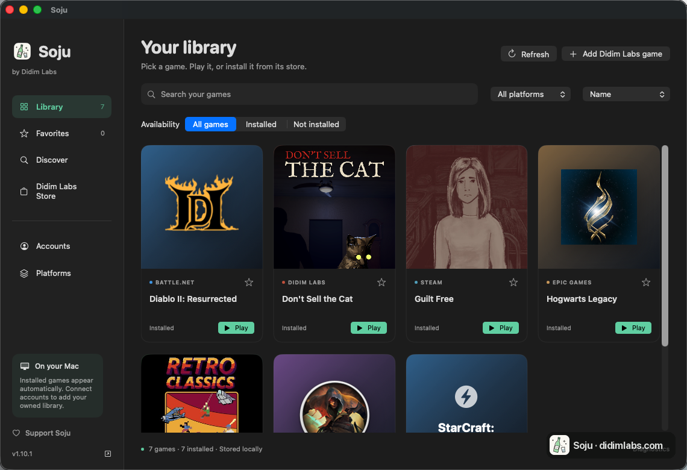

<p align="center"></p>

# Soju（简体中文）

> **在 Apple Silicon Mac 上玩 Windows 游戏，免费开源。**

Soju 在 M1 及更新的 Mac 上安装 **Battle.net、Steam、Epic Games、GOG GALAXY、EA app、Rockstar Games Launcher 和 Ubisoft Connect** 的官方 Windows 客户端，每个客户端使用独立的 Wine 环境，并把游戏集中显示在一个 Mac 游戏库里。项目最初是为了不用 CrossOver 也能运行战网和 Diablo II: Resurrected。



**[下载 Soju 1.14.3（Mac）](https://github.com/BCD1210/soju/releases/download/v1.14.3/Soju-1.14.3-macos-arm64.zip)**，或在终端安装：

```bash
brew install BCD1210/soju/soju
soju install
```

应用需要 macOS 14 或更高版本。Diablo II: Resurrected 需要 macOS 26.4 或更高，Steam 游戏需要 macOS 26 或更高。

[能跑什么](#能跑什么) · [安装说明](#安装一行命令) · [30 秒游戏演示](https://didimlabs.com/#demo) · [Discord](https://discord.gg/ttBDcF5ftz) · [English](README.md) · [한국어](README.ko.md)

各游戏的兼容性不同，带内核级反作弊的游戏无法运行。项目不包含游戏和商店客户端。Apple GPTK 文件由 Soju 在安装时下载。

## 能跑什么

<!-- 截图：把 PNG（d2r-ingame.png、battlenet-login.png、hogwarts-ingame.png）放进 docs/images/ 后取消注释。
<p align="center">
  
  
</p>
-->

均在 M4 Pro / macOS 26.5 上验证。每个启动器使用独立 bottle；Steam 的引擎也独立。

| 登录器 | 登录 | 安装游戏 | 说明 |
| --- | :-: | :-: | --- |
| 战网（Battle.net） | ✅ | ✅ | Agent 正常；`BLZBNTBNA00000005` 通过签名 exe 播种解决 |
| Epic Games Launcher | ✅ | ✅ | 关闭窗口后驻留菜单栏托盘 |
| GOG GALAXY | ✅ | ✅ | 登录和游戏库可用；游戏尚未广泛测试 |
| EA app | 登录窗口 | 尚未测试 | 1.11 新增，启动器引擎（DXMT） |
| Rockstar Games Launcher | 登录窗口 | 尚未测试 | 1.11 新增，启动器引擎（DXMT） |
| Ubisoft Connect | 登录窗口 | 尚未测试 | 1.11 新增，启动器引擎（DXMT） |
| Steam（Windows 客户端） | ✅ | ✅ | 独立的 Wine 11 + DXMT bottle |
| Xbox PC / Microsoft Store | ✅ | ✅ | Xodus 后端；游戏启动为实验功能（Retro Classics 可进入主菜单） |

| 游戏 | 平台 | 图形 | 状态 | 说明 |
| --- | --- | --- | :-: | --- |
| Diablo II: Resurrected | 战网 | D3DMetal (D3D12) | ✅ 进入游戏，可联网 | **需要 macOS 26.4 或更高**（见前提条件）；`play.sh` 设置 `ROSETTA_ADVERTISE_AVX=1`；[指南](https://didimlabs.com/guides/diablo-2-resurrected-apple-silicon.html) |
| Diablo II: Resurrected VR（离线） | 战网 | D3DMetal (D3D12) + OpenXR | 🧪 仅在模拟器验证 | `soju vr setup` / `soju vr play`：离线角色的 D2R VR Unleashed，串流到 OXRSys 头显客户端；[docs/VR.md](docs/VR.md) |
| Hogwarts Legacy | Epic | D3DMetal (D3D12) | ✅ 进入游戏 | UE4 的"AMD 驱动"警告无害 |
| StarCraft: Remastered | 战网 | 未确认 | ✅ 进入游戏 | 战网更新游戏后可开始对电脑的单人对战；多人对战未测试 |
| Unity D3D11 游戏 | Steam | DXMT | ✅ 进入游戏，窗口模式 | 需要 `soju steam-games`，见 [docs/STEAM-GAMES.md](docs/STEAM-GAMES.md) |
| 守望先锋 2 | Steam | D3DMetal（Steam GPTK 模式） | ✅ 主菜单，在线 | `soju steam-gptk on`（或 Platforms > Steam > Overwatch and Diablo II mode）；首次会要求连接一次 Battle.net 账号 |
| Diablo II: Resurrected（Infernal Edition） | Steam | D3DMetal（Steam GPTK 模式） | ⏳ 尚未验证 | 需要 `soju steam-gptk on`：D2R 加载器需要的 GPTK `libd3dshared` 现在会像守望先锋 2 一样传给 Steam 游戏；我们没有 Steam 版，尚未实际运行 |

跑不了的：任何带内核级反作弊（EAC、BattlEye、Vanguard）的游戏。有问题或想简单反馈，欢迎加入 [Discord](https://discord.gg/ttBDcF5ftz)。跑通了别的游戏？欢迎发到 [Discussions](https://github.com/BCD1210/soju/discussions)，或提 PR 加一行。

## 安装（一行命令）

```bash
curl -fsSL https://didimlabs.com/install.sh | bash
```

或者用 Homebrew：

```bash
brew install BCD1210/soju/soju
soju install     # 然后：soju battlenet / soju d2r / soju steam / soju epic / soju gog / soju ea / soju rockstar / soju ubisoft
```

安装器会**先询问要安装哪些启动器，再下载对应组件**。仅选择 Steam 时，不会下载 CX 引擎或 Apple GPTK。Steam 图形组件经过 SHA-256 校验后，自动安装到 Soju 专用的 Wine 11.0 环境中。战网、Epic 和 GOG 使用共享 CX 引擎及用户单独下载的 Apple GPTK。各客户端的 bottle、账户和游戏分别保留。

[下载 Soju Mac 应用](https://github.com/BCD1210/soju/releases/download/v1.14.3/Soju-1.14.3-macos-arm64.zip)：原生桌面预览版在一个窗口中管理已安装和已拥有的游戏、商店搜索、收藏、游戏启动和平台管理。[安装说明与要求](docs/DESKTOP.md)。

## 日常维护

```bash
soju doctor      # 体检：检查整个栈，指出哪里不对（提 issue 时请附上输出）
soju update      # 更新脚本和预编译引擎（保留 GPTK 和所有 bottle）
soju uninstall   # 卸载：逐项确认后删除 app、bottle 和引擎
```

## 应用里的其他功能

- **导入已购游戏：** 通过 Steam 官方登录导入已购游戏（无需 API 密钥），也可导入 GOG GALAXY 本地缓存的游戏库。已安装和未安装的游戏显示在同一个游戏库里。暂不支持 Epic 和 Battle.net 的账户游戏库导入。[设置说明](docs/ACCOUNTS.md)
- **Discover：** 搜索 Steam、GOG 和 Microsoft Store 的商品与价格，并链接到官方商店。
- **Platforms：** 管理启动器安装、组件更新和诊断。CLI 和各启动器的快捷应用仍可使用。
- **Xbox PC（实验功能）：** 见下文 [Xbox PC / Microsoft Store](#xbox-pc--microsoft-storexodus-后端实验功能)。
- **电视和 iPad：** 在 Soju 中开启串流，在电视、iPad 或手机上安装免费的 Moonlight，输入它显示的 PIN，就能在那块屏幕上玩 Mac 上运行的游戏。
- **Didim Labs Store：** 出售我们自己制作的 Mac 游戏，不需要 Wine。

主 Wine 引擎基于 CodeWeavers 公开源码构建，Steam 使用独立的 Wine 11 环境。

## 为什么会有这个项目

社区 Wine 构建（Whisky、Kegworks 时代的引擎）已经无法运行新版战网和 D2R。商业方案可以用，但其底层 Wine 引擎是 GPL 的，所以我们自己把它编译出来，并记录了撞上的每一堵墙。以下记录了其中三个问题的诊断和修复：

### 三把钥匙

1. **`ROSETTA_ADVERTISE_AVX=1`**：D2R 的加载器要求 AVX 指令集。没有这个环境变量，游戏会在任何图形初始化之前，卡在约 86 MB 内存、0% CPU 的状态永远不动。这就是非 CrossOver 的 Wine 构建上 "D2R 启动即卡死" 的真相。

2. **D3DMetal 载荷布局**：Apple Game Porting Toolkit 的载荷分三部分，三者齐全 D3DMetal 才会生效：`lib/external/`（libd3dshared + D3DMetal.framework）；Apple 的 PE 垫片 `d3d11.dll`、`d3d12.dll`、`dxgi.dll`（以及 `atidxx64`、`nvapi64`、`nvngx`），放在 `lib/wine/x86_64-windows/` 下替换 Wine 自带的同名 DLL；以及每个垫片对应一个 `lib/wine/x86_64-unix/<垫片>.so`，必须是指向 `lib/external/` 的**符号链接**。直接复制文件会破坏 `@loader_path` 解析，D3DMetal 会陷入断言循环；若保留 Wine 自带的 `d3d11.dll`，D3D 会走 wined3d，Epic Games Launcher 启动即崩溃。`soju gptk` 会安装全部三部分。

3. **战网 Agent 调用方签名修复**：Agent 校验连接客户端的签名时，用的是相对文件名，相对于它自己的工作目录（一个带版本号的子目录）解析。把签名过的 `Battle.net.exe` 复制一份到每个 `Battle.net.NNNNN` 子目录即可通过校验（修复错误 `BLZBNTBNA00000005`）。

另外一个陷阱：启动链里绝不能出现 Apple 平台二进制（`nohup`、`arch` 等）。macOS 在 exec 它们时会剥掉 `DYLD_*` 环境变量。

**指南（英文）：** [D2R on Apple Silicon](https://didimlabs.com/guides/diablo-2-resurrected-apple-silicon.html) · [Windows Steam client](https://didimlabs.com/guides/steam-windows-client-apple-silicon.html) · [Whisky alternatives](https://didimlabs.com/guides/whisky-alternative.html)

## 或者完全自己构建：不需要 CrossOver

Apple 的 Game Porting Toolkit 文件在第 4 步下载。如果想用自己从 Apple 下载的版本，用免费 Apple ID 下载 dmg 并先挂载即可。

```bash
# 1. 获取脚本
git clone https://github.com/BCD1210/soju.git && cd soju

# 2. 获取运行时组件（x86_64 动态库 + wine-mono，全部来自免费的 GPL 发布）
scripts/get-components.sh

# 3. 从 GPL 源码构建引擎（30-60 分钟）
scripts/build-engine.sh

# 4. 安装 Apple GPTK（下载 Apple 的文件并校验 Apple 签名）
scripts/fetch-gptk.py
#    （也可以挂载 Apple 的 "evaluation environment for Windows games" dmg 后运行
#    scripts/get-gptk.sh；如果装了 CrossOver，脚本会从中提取）

# 5. 创建 bottle + 安装战网（Blizzard 官方安装包，全自动）
scripts/create-bottle.sh

# 6. 开玩
scripts/play.sh battlenet   # 登录器 -> 登录 -> 安装并运行你的游戏
scripts/play.sh d2r         # 直接启动 D2R（离线）
scripts/play.sh kill        # 全部停止
```

已经有装好游戏的 CrossOver bottle？`scripts/setup-bottle.sh` 会克隆它（省下 28 GB 的游戏重新下载）。

## Epic Games Launcher

同一个引擎，独立 bottle，不需要额外招数：Epic 的 CEF 在这个构建上 GPU 进程能存活，登录器用原始命令行即可运行。2026-08-29 验证：官方 MSI 无人值守安装（约 30 秒）、登录器界面、登录。

```bash
scripts/create-epic-bottle.sh    # 官方 Epic MSI，无人值守
scripts/play.sh epic             # 登录 -> 安装并游玩
scripts/play.sh epic-kill        # 停止 Epic bottle（关窗口会缩到菜单栏托盘；点 Dock 图标恢复）
```

2026-08-30 验证：从登录器安装 71 GB 的《霍格沃茨之遗》（UE4，D3D12 走 D3DMetal），进入游戏。两点提示：中日韩输入法已经不影响了（engine-v1.5 起像 Windows 一样，用输入法底下的英文布局生成键表，游戏中切到中文再切回来也没问题）；如果游戏以全屏启动，请在游戏自己的显示设置里改成窗口模式（Soju 不强制）。wine 11.0 的一个已知问题：在多个 Wine 窗口（登录器、游戏、另一个 bottle）之间切换几次后，游戏可能收不到键盘输入，重启游戏即可；上游在 wine 11.11 修复。

### EA app、Rockstar Games Launcher、Ubisoft Connect

```bash
soju ea-install        # 或 rockstar-install / ubisoft-install：独立 bottle，官方安装程序
soju ea                # 或 rockstar / ubisoft：登录、安装和游玩
soju ea-kill           # 或 rockstar-kill / ubisoft-kill
```

2026-11-10 验证：三个客户端都能安装并打开登录窗口（未登录账户，游戏尚未测试）。它们的窗口是 Chromium 浏览器，GPU 进程把画面画到另一个进程的窗口里，Wine 的 Mac 驱动无法显示，所以在 CX 引擎上窗口是白色或黑色。因此它们运行在第二个引擎上：在你的 Mac 上从 CX 引擎克隆（APFS 克隆，不额外占用空间），再加上 launcher-support 组件，即带 `patches/winemac-cross-process-swapchains.patch`（来自 Highball，Wine bug 60263）的 Mac 驱动，以及可跨进程显示的 Direct3D 10/11 DXMT。战网、Epic 和 GOG 仍使用原来的 CX 引擎。EA app 首次启动会自我更新；之后如果窗口是空的，退出再打开即可。

### GOG GALAXY

```bash
scripts/create-gog-bottle.sh      # 独立 bottle，官方网页安装器（静默）
scripts/play.sh gog               # 登录、安装、游玩
scripts/play.sh gog-kill          # 停止 GOG bottle（关窗口会缩到菜单栏托盘）
```

2026-08-30 验证：安装、登录、游戏库。GOG GALAXY 2.x 是 Qt6 + QtWebEngine 而不是 CEF，在这个引擎上窗口会黑屏：Qt 的 D3D11 合成会向 D3DMetal 的 DXGI 要 `IDXGIResource`，而后者没有实现。解法是让 Chromium 走 CPU 渲染（`--disable-gpu`），但 GOG 会自己覆盖 `QTWEBENGINE_CHROMIUM_FLAGS`、无视自己的命令行参数，还会校验自身可执行文件，引擎外部没有任何注入手段。因此引擎带了一个小钩子（`patches/chromium-flags-append.patch`）：每当程序设置 `QTWEBENGINE_CHROMIUM_FLAGS` 时，把 `SOJU_CHROMIUM_FLAGS` 的内容追加上去。`play.sh gog` 会设置它。同一组补丁还加了 `WINE_CUSTOM_FRAME`，阻止 Mac 驱动在 GOG 自绘标题栏上再叠一个 macOS 标题栏。细节见 [docs/DIAGNOSIS.md](docs/DIAGNOSIS.md)。

游戏尚未大范围测试；需要内核级反作弊（EAC/BattlEye）的游戏在 Wine 下无法运行。

## Xbox PC / Microsoft Store（Xodus 后端，实验功能）

可以登录 Microsoft 账户，导入已拥有的游戏和 PC Game Pass 游戏，搜索 Microsoft Store 并下载游戏。也可以启动下载好的游戏（实验功能：在 M4 Pro / macOS 26.5 上已确认 Retro Classics 能进入主菜单，其他游戏尚未测试；按游戏的 Wine 设置在 `resources/xbox-compat.json`）。启动需要 CX 引擎和 Apple GPTK：设置 Xbox PC 时会安装引擎，GPTK 与 Battle.net、Epic、GOG 一样在 Platforms 中添加。

启动流程：`xodus-cli run` 获取许可证并把游戏解密到临时 RAM 盘，`scripts/xbox-wine.sh` 在独立前缀（`xbox-bottle`）中用 CX 引擎和 D3DMetal 运行。该前缀包含 Xbox 游戏运行时 DLL（xgameruntime 等，LGPL，固定在 `resources/xbox-runtime.json`，首次下载约 600 MB）和 Microsoft VC++ 运行库。游戏期间 `xodus-service` 负责登录、许可证和云存档，游戏写入的文件在退出时复制回游戏目录。在 Library 中点 **Stop** 关闭游戏时会先复制存档。

后端是 [Xodus](https://github.com/xodus-gaming/xodus)（GPL-3.0），没有 macOS 发行版，所以 `soju xbox-install` 会在你的 Mac 上构建：固定提交的 Xodus 源码加上 [MACxus](https://github.com/fladnaG86/MACxus)（MIT）的 44 个补丁，补丁和 `Cargo.lock` 都校验 SHA-256，用 rustup 的 Rust 1.99 构建。

```bash
soju xbox-install            # 构建后端
soju xbox-login              # Microsoft 官方登录窗口
soju xbox-sync US            # 导入已拥有和 Game Pass 游戏
soju xbox-download 9N116V0599HB   # 按商店产品 ID 下载，再次运行可续传
soju xbox-logout             # 退出登录（已下载的游戏保留）
```

只支持 MSIXVC 格式的 GDK 游戏，MSIXVC2 暂不支持（[xodus#53](https://github.com/xodus-gaming/xodus/issues/53)）。登录信息保存在 macOS 钥匙串的 "Xodus Service" 项中。Soju 只保存游戏 ID、标题、包格式、封面和用作账户标签的 Xbox 玩家代号，不保存账户邮箱和令牌。使用 Easy Anti-Cheat 的游戏无法在 macOS 上联机。

## Steam（包括 Steam 版 D2R）

**Steam GPTK 模式**（`soju steam-gptk on`，或 Platforms > Steam > Overwatch and Diablo II mode）：Steam 和 Steam 游戏使用与 Battle.net 相同的引擎和 Apple GPTK，并换用能显示 Steam 浏览器窗口的 Mac 驱动。适用于 D3D12 游戏和 Steam 上的暴雪游戏（守望先锋 2 已在线进入主菜单；D2R 需要 GPTK 的 `libd3dshared`）。它使用复制自 Steam bottle 的独立 bottle，不额外占用空间，已安装的游戏仍在；需要在其中登录一次 Steam。`soju steam-gptk off` 可回到 Wine 11 + DXMT，原登录仍在。

D2R 于 2026 年 2 月以 *Infernal Edition* 上架 Steam。Steam 支持用的是**另一个免费引擎**：新版 Steam 客户端的 CEF 界面在 CrossOver 源码构建上无法渲染（黑窗口，跨进程交换链 + CEF 沙箱问题），但在 Homebrew 的 `wine-stable` 11 上，配合一个强制 `--disable-gpu --single-process` 的小 `steamwebhelper` 包装器就能工作。该修复来自 [notpop/steam-on-m1-wine](https://github.com/notpop/steam-on-m1-wine)（MIT，包装器源码收录在 `third_party/`）。Steam 有自己独立的 bottle，两套栈互不干扰：

```bash
scripts/create-steam-bottle.sh   # 安装 wine-stable + 包装器 + Valve 官方安装包
scripts/play.sh steam            # 登录 -> 安装并游玩
scripts/play.sh steam-kill       # 停止 Steam bottle
```

在 M4 Pro / macOS 26.5 上验证：登录、游戏库，以及一个真实 D3D11（Unity）游戏通过 DXMT 分支在游戏内渲染。完整接线见 `docs/STEAM-GAMES.md`（`scripts/setup-steam-games.sh`）。注意：在 Steam 里打字时把 macOS 输入法切到英文（ABC），否则输入法合成会显示为 `?`。

**前提条件**：Apple Silicon Mac、Rosetta 2、Xcode 命令行工具、Homebrew、以及你自己的战网账号/游戏。**《暗黑破坏神 II：狱火重生》需要 macOS 26.4 或更高**：暴雪 2026 年 1 月加入的反作弊会触发一个 Rosetta 2 的 bug，Apple 在 26.4 修复了它。在 macOS 15 上游戏启动后立刻退出（战网随后显示"更新"并卡在正在初始化），CrossOver 也一样。启动器和其他游戏不受这个 bug 影响，但所有验证都只在 macOS 26.5 上做过。本仓库不再分发 Apple、Blizzard 或 CodeWeavers 的任何文件。

### 为什么必须要 GPTK？

`libd3dshared.dylib`（GPTK 内）不只是图形库：D2R 的加载器需要它的*非原生代码区域注册*才能通过 Rosetta 2。没有它，即使已开启 AVX 广播，游戏也会在启动时卡死。图形本身可以在没有 D3DMetal 时用纯开源的 vkd3d/MoltenVK 运行。

### 疑难解答

先跑一遍 `soju doctor`：它会检查下面大部分条目并直接指出问题。

- **弹出 "Wine Mono Installer"** -> 跳过了第 2 步；运行 `get-components.sh` 后重新 `build-engine.sh`。
- **游戏卡在约 86 MB 内存、0% CPU** -> `ROSETTA_ADVERTISE_AVX=1` 或 `libd3dshared` 没有传到游戏。只通过 `play.sh` 启动，并检查第 4 步。
- **找不到库（gnutls/freetype 报错）** -> 你通过 `nohup`/`arch`/其他 Apple 签名的二进制启动了 wine，`DYLD_*` 变量被剥掉了。请通过 `play.sh` 启动。
- **战网登录 webview 偶尔闪烁（约一分钟一次）** -> 已知的外观问题；会自动恢复，不影响登录。
- **虚幻引擎游戏启动时提示 "The installed version of the AMD graphics driver has known issues"**（《霍格沃茨之遗》等）：D3DMetal 把自己伪装成旧驱动版本的 AMD 显卡，触发了 UE4 的驱动检查。无害，点确定即可；想彻底关掉就在游戏的用户 `Engine.ini`（`AppData/Local/<游戏>/Saved/Config/WindowsNoEditor/` 下）加入 `[SystemSettings]` / `r.WarnOfBadDrivers=0`。
- **GOG GALAXY：通知弹出时右下角出现黑色矩形**，随通知一起消失。通知是 GOG 通知渲染器的透明分层窗口；没有 DWM 合成时 Wine 会把透明区域涂黑。无害。在 GOG 设置里关闭桌面通知即可避免。
- **移动键卡在按下状态，或者鼠标正常但键盘完全没反应**（在 Hogwarts Legacy 中出现过）：按住键的时候键盘焦点被另一个 Wine 窗口抢走了。常见元凶是 Epic（EOS）覆盖层，所以 `soju epic` 现在默认禁用它（`SOJU_EPIC_OVERLAY=1` 可恢复；先 `soju epic-kill` 再重启登录器才会生效）。v1.5 之前的引擎还有第二个原因：中日韩输入法会让字母键变成假名或字母以外的字符，虚幻引擎的游戏会直接丢弃（只有 Esc、方向键和 F 键有效），切换瞬间按住的键也会卡住；在那些引擎上请保持英文（ABC），或者更新引擎（`soju update`）。仍然复现？`SOJU_KEYLOG=1 soju epic` 会把按键和焦点日志写到 `~/.battlenet-macos/logs/`，提 issue 时附上。
- **Epic 提示 "your account has too many active logins"**，而且在所有设备退出登录、甚至重置密码后依旧如此。账号服务实际返回的是 `too_many_sessions`（18048），限制的是*已发放*的会话数量而非当前持有的数量，所以反复重试只会更糟。旧引擎上启动几次就会触发，因为 Wine 无法保存登录器的设备密钥，详见 `patches/ncrypt-persisted-keys.patch`。先停掉 bottle（`soju epic-kill`），放置几个小时等计数器清零，然后只启动一次。
- **游戏退出后（或启动失败后）Battle.net 停在"更新"（正在初始化），Play 按钮消失**：每当游戏进程结束，启动器都会重新检查安装。暂停更新再恢复，Play 按钮就会回来，游戏正常启动。如果安装后第一次 Play 在一分钟内退出，再按一次 Play：目前报告过一次，第二次启动正常。如果暂停按钮完全没有反应，说明客户端本身已经卡死（见于连续运行一周后，Battle.net.exe 占满 CPU）：从 Dock 退出 Battle.net 再重新打开，Play 按钮就会回来。
- **PlayStation 手柄（DualShock 4、DualSense）已配对，macOS 能识别，但游戏没有反应**（蓝牙 DualShock 4 + D2R，#42）：打开 `soju controllers`，手柄只出现在 DirectInput 下，XInput 槽位全空。Wine 默认通过 raw HID 后端接入索尼手柄，而在 macOS 上这个后端不会把它们呈现为 XInput 手柄，暴雪的游戏只认 XInput。现在 `soju battlenet` 会把索尼手柄改走 SDL 路径（按厂商 ID 写的注册表项，需要 raw HID 的方向盘和摇杆不受影响），手柄就以 Xbox 手柄的形式工作。这个设置在 bottle 启动时只读一次：如果 Battle.net 已经开着，先用 `soju kill` 彻底停掉（只关窗口可能让 bottle 继续运行一阵）再重新打开。在 `soju controllers` 里勾选 "Disable hidraw" 对所有设备都有同样效果。要让索尼手柄恢复 raw HID，把 `HKLM\System\CurrentControlSet\Services\WineBus\Devices\054C` 下的 `Hidraw` 设为 1。
- **Steam 始终不显示登录窗口**（`steam.exe` 和 `steamwebhelper` 停在 0% CPU，`dumps/` 里出现内容为 `BMainLoop appears to have stalled` 的 `assert_steam.exe_*.dmp`；#55）：Steam 使用的 Wine 11.0 会在 Steam 主循环里逐个格式探测 Mac 的所有音频设备，在部分 Mac 上耗时超过 Steam 允许的上限。现在 `soju steam` 只让 Steam 客户端进程本身不接触 Core Audio，下次启动即可解决（若已卡住，先执行 `soju steam-kill`）。游戏和商店视频仍有声音，只有客户端自己的音频（如语音聊天）被关闭。要恢复，在 Steam 容器的 `HKCU\Software\Wine\AppDefaults\steam.exe\DllOverrides` 下把 `winecoreaudio.drv` 设为 `builtin`。
- **BLZBNTBNA00000005** -> `play.sh` 会自动播种签名 exe；请确认是通过它启动的。

### 残留的 Wine 进程

每次启动 bottle 都会附带一组空闲的 Windows 服务进程（`services.exe`、`winedevice.exe`、`plugplay.exe`、`rpcss.exe`、`explorer.exe /desktop`，每组约 100 MB）。如果 bottle 的 `wineserver` 被强杀（崩溃、中断的运行），这些服务不会察觉，会一直挂着。`scripts/soju-sweep.sh` 负责清掉它们，`play.sh kill` / `epic-kill` / `steam-kill` 和守护进程会自动调用。它它只清理不属于任何运行中 `wineserver` 的服务进程（存活 bottle 的每个进程都在其服务端 socket 目录里打开着文件），因此正在运行的游戏或登录器绝不会被误伤，即使其他 bottle 还在运行也一样。可用 `soju sweep` 手动执行。

## 仓库里有什么

- `scripts/build-engine.sh`：完整的引擎构建配方（freetype 交叉构建、gnutls 接线、GPTK 布局、entitlements）
- `scripts/setup-bottle.sh` / `scripts/play.sh`：bottle 创建和验证过的启动环境
- `docs/DIAGNOSIS.md`：CEF 渲染进程崩溃与 Agent 签名失败的深度分析
- `docs/D2R-GAME-LAUNCH.md`：D2R 加载器调查全记录，包括死胡同
- `research/`：结论对应的原始日志证据

## 许可

- 本仓库的脚本和文档：**GPL-3.0**（见 LICENSE）
- 引擎构建自 CodeWeavers 公开的 Wine 源码（GPL/LGPL）。来源：`media.codeweavers.com/pub/crossover/source/`
- **不包含且永远不会包含**：Apple D3DMetal/GPTK 二进制（禁止再分发）、CrossOver 应用二进制、任何 Blizzard 文件
- 本项目与 CodeWeavers、Apple、Blizzard Entertainment 均无关联。Battle.net 和 Diablo 是 Blizzard Entertainment 的商标。使用风险自负；使用第三方兼容层进行在线游戏请自行斟酌。

## 提交游戏兼容性结果

欢迎提交成功、部分可用或失败的测试结果，并注明游戏、商店、Mac 型号、macOS 和 Soju 配置。需要登录 GitHub，报告会公开显示。

[提交游戏兼容性结果](https://github.com/BCD1210/soju/issues/new?template=compatibility.yml)
